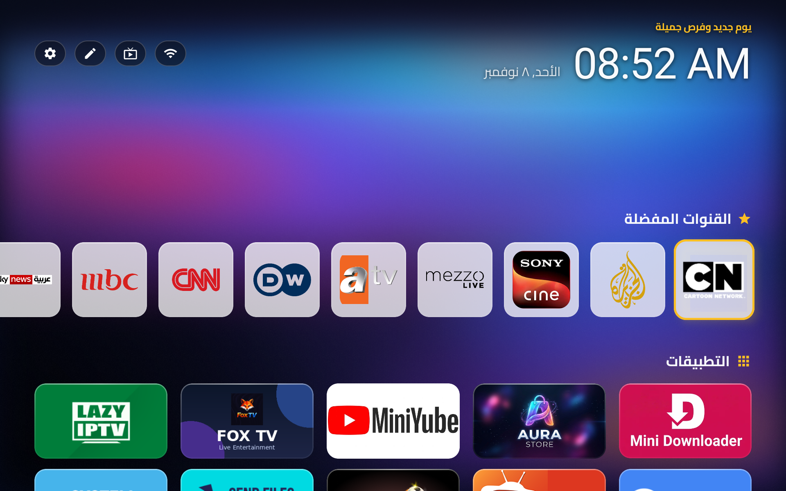
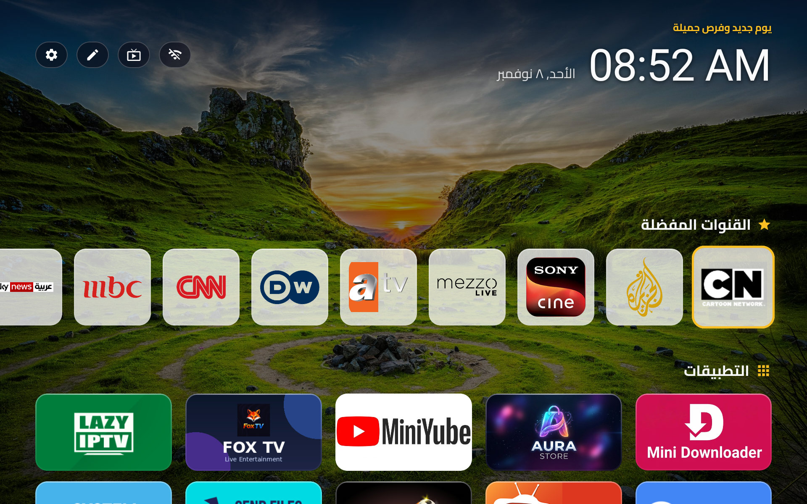
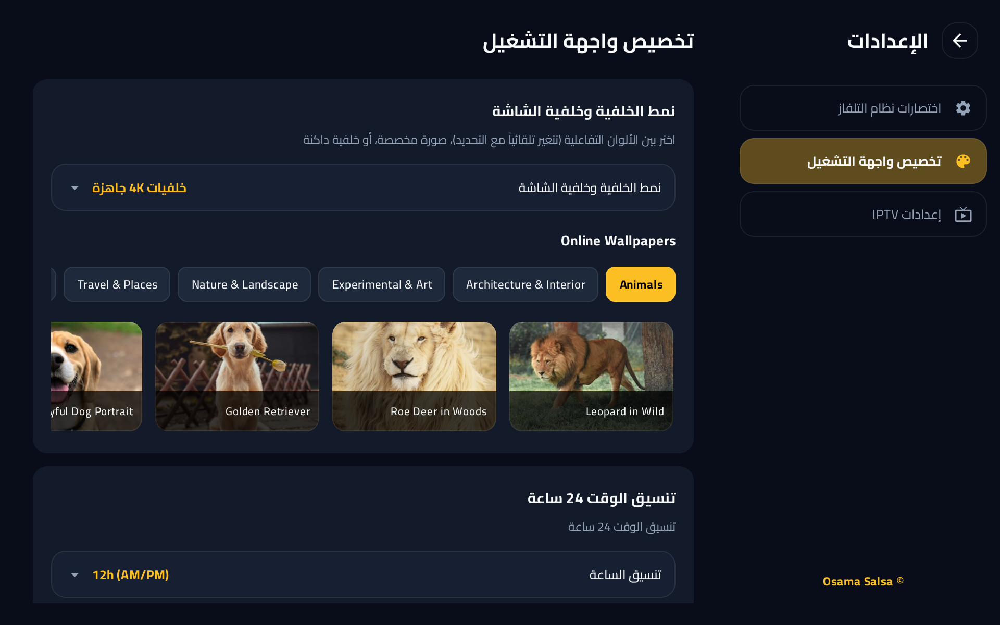
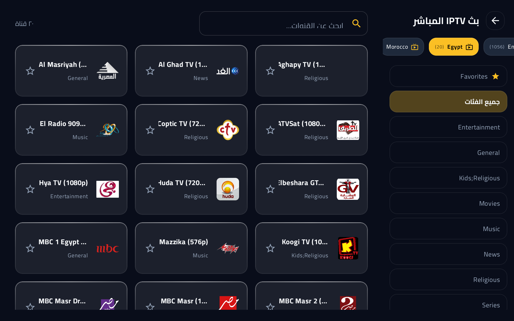
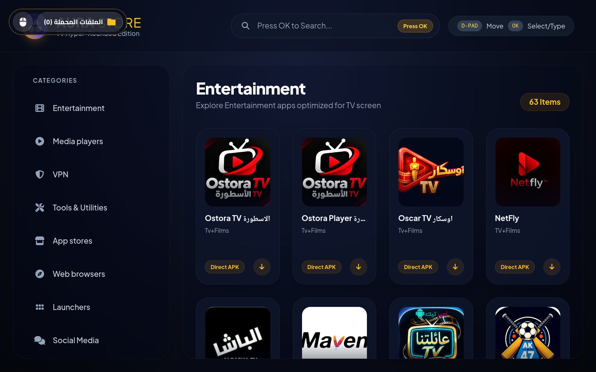
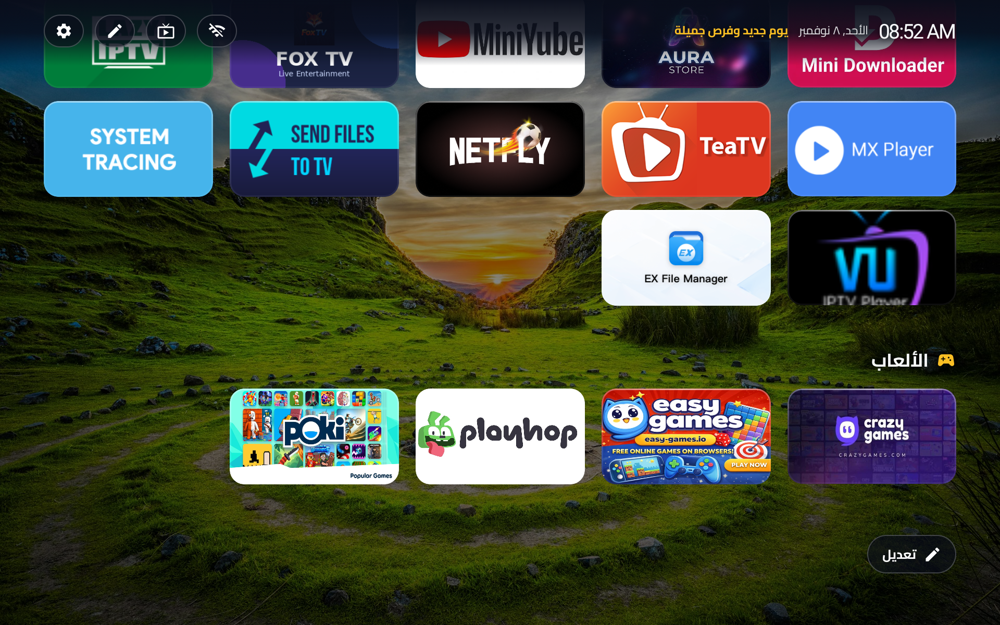
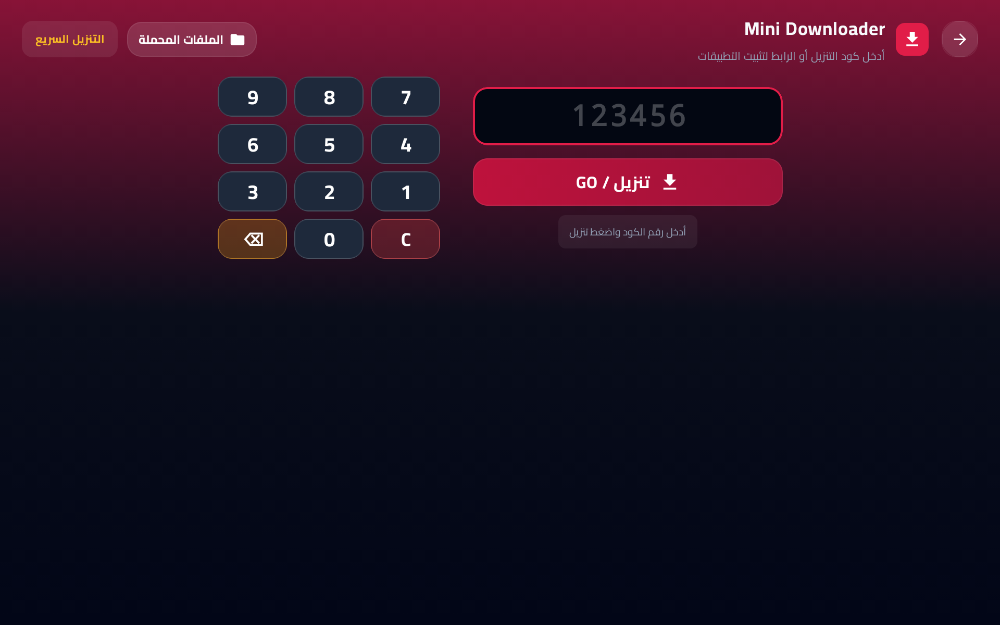

[English](README.md) | **العربية** | [Deutsch](README_de.md) | [Français](README_fr.md) | [Italiano](README_it.md) | [Русский](README_ru.md) | [Español](README_es.md) | [Português](README_pt.md) | [Türkçe](README_tr.md) | [Polski](README_pl.md) | [Nederlands](README_nl.md) | [Ελληνικά](README_el.md) | [Bahasa Indonesia](README_id.md) | [Tiếng Việt](README_vi.md) | [ไทย](README_th.md) | [中文](README_zh.md) | [日本語](README_ja.md) | [한국어](README_ko.md) | [हिन्दी](README_hi.md) | [اردو](README_ur.md) | [فارسی](README_fa.md)

<div align="center">

# 📺 Aura TV Launcher



**لانشر ومركز وسائط حديث، فائق السرعة، خفيف، وقابل للتخصيص بالكامل، وخالٍ من الإعلانات بنسبة 100% لأجهزة Android TV مبني بواسطة Jetpack Compose.**  
*الحل الشامل الذي يغنيك عن عشرات التطبيقات المنفصلة على تلفازك الذكي.*

[](https://developer.android.com/tv)
[](https://github.com/OsamaSalsa/Aura-TV-Launcher)
[](https://github.com/OsamaSalsa/Aura-TV-Launcher)
[](https://kotlinlang.org/)
[](https://developer.android.com/jetpack/compose)

---

</div>

<div dir="rtl">

## 🚀 الحل الشامل لأجهزة التلفاز

معظم واجهات التلفاز الذكي الحالية مليئة بالإعلانات الإجبارية، ومقاطع الفيديو الترويجية الثقيلة، والتوصيات غير المرغوبة، والاستجابة البطيئة.

**Aura TV Launcher** صُمم ليكون البديل المثالي: واجهة نظيفة وفائقة السرعة وخفيفة جداً تجمع كافة احتياجات الترفيه المنزلي في تطبيق واحد بدون أي إعلانات أو برمجيات خفية.

### ✨ 7 وحدات أساسية متكاملة
1. **🚀 لانشر فائق السرعة وخفيف**: إقلاع فوري، وتوليد مسبق للرموز بالتوازي عبر أنوية المعالج، وتنقل سريع ومريح بمعدل 60 إطاراً في الثانية.
2. **📺 مشغّل IPTV مدمج مع شريط المفضلة**: دعم تشغيل روابط M3U مع إمكانية الوصول لقنواتك المفضلة وتشغيلها بنقرة واحدة مباشرة من الشاشة الرئيسية.
3. **🎥 MiniTube**: بوابة YouTube Leanback المخصصة للتلفاز للتشغيل السريع كضيف بدون تسجيل دخول أو تعقيدات.
4. **📥 Mini Downloader**: أداة تحميل عالية السرعة للملفات وحزم APK مع مثبّت ذكي تلقائي بنقرة واحدة.
5. **🛒 Aura Store**: سوق تطبيقات ويب خفيف ومباشر لتثبيت وتحديث برامج وأدوات التلفاز.
6. **🕹️ 4 بوابات ألعاب مدمجة**: آلاف ألعاب الويب الخفيفة تعمل فوراً بدون تنزيل (**CrazyGames** و **Poki** و **Playhop** و **EasyGames**).
7. **🛡️ حاجب إعلانات وتتبع على مستوى الجهاز**: حماية AdGuard DNS المدمجة لحظر النوافذ الإعلانية وأدوات التتبع عبر كامل النظام.

---

## 🌟 أحدث الميزات والإضافات المطوّرة

### ⚡ سرعة فائقة وتجاوب فوري بين التطبيقات
* **ظهور فوري لجميع الأيقونات والشعارات**: معالجة وفك تشفير أيقونات التطبيقات مسبقاً في الخلفية بالتوازي عبر جميع أنوية المعالج، لتظهر جميع الرموز في اللحظة الأولى لتشغيل اللانشر بدون أي انتظار.
* **تنقل خاطف بالريموت (110ms)**: تسريع حركة التركيز والتكبير والانتقال بين التطبيقات بالكامل عبر معالج الرسوميات (`graphicsLayer`) بزمن استجابة قياسي يبلغ 110 ملي ثانية فقط.
* **إضاءة محيطية خفيفة على المعالج**: استبدال فلاتر الضبابية المزدوجة الثقيلة بتدرجات شعاعية انسيابية مدمجة، مما خفّض استهلاك معالج التلفاز وضمن حركة ناعمة وثابتة.
* **واجهة نظيفة (حذف زر Edit السفلي)**: تم الاستغناء عن زر Edit السفلي لجعل الشاشة الرئيسية واسعة ومريحة، مع إمكانية التعديل وترتيب البرامج بكل سهولة عبر الضغط المطول بالريموت (زر `OK` أو زر `القائمة Menu`).

### 🌙 ذكاء شاشة التوقف وتفويض شاشات التوقف الخارجية
* **التفويض الكامل لشاشة توقف النظام أو الخارجية (`معطل / Disabled`)**: عند اختيار تعطيل شاشة التوقف الداخلية، يقوم التطبيق تلقائياً بإلغاء حظر السبات (`FLAG_KEEP_SCREEN_ON`)، مما يتيح لشاشة التوقف التابعة لنظام التلفاز أو أي تطبيق خارجي العمل في موعدها الطبيعي.
* **شاشة التوقف الداخلية الذكية (`مفعل`)**: عند تحديد وقت سبات (2، 5، 10، 15، أو 30 دقيقة)، يظل التطبيق نشطاً ويمنع شاشات النظام، ليعرض نمط التوقف الذي تفضله:
  * **نمط الساعة والتاريخ**: ساعة رقمية مضيئة كبيرة مع حماية الشاشة من الاحتراق (Drift Protection).
  * **نمط خلفية 4K مع معلومات أسفل الشاشة**: خلفية طبيعية بجودة 4K مع تدرج زاوي أنيق (45 درجة) يبرز الساعة والتحية والتاريخ بوضوح.
  * **فيديو سينمائي ملء الشاشة**: تشغيل مباشر لفيديوهات المدفأة أو الأكواخ الثلجية أو الشلالات بدون أي نصوص أو أزرار أو حظر روبوت.
  * **عرض شرائح الصور المتحرّك (`Slideshow`)**: حوّل شاشة تلفازك إلى معرض فني حي يعرض صورك من مجلد مخصص في ذاكرة الجهاز أو فلاشة USB، أو صور مختارة، أو معارض 4K جاهزة:
    * **زمن كل صورة والعشوائية**: التحكم بزمن بقاء كل صورة (`5 ثوانٍ`، `10 ثوانٍ`، `15 ثانية`، `30 ثانية`، `دقيقة`، `5 دقائق`) مع خيار العرض العشوائي.
    * **طريقة عرض وحركة الصورة**: الاختيار بين **حركة سينمائية ناعمة (Ken Burns)**، أو **تقريب هادئ (Gentle Zoom)**، أو **صورة ثابتة (Static)**.
    * **تأثيرات دخول الصور**: **تلاشي ناعم (Crossfade)**، **انزلاق جانبي (Slide)**، **تقريب وتلاشي (Zoom & Fade)**، **ظهور تدريجي (Soft Scale)**، **قلب ثلاثي الأبعاد (3D Flip)**، أو **تأثير عشوائي متجدد**.
    * **تأثيرات جوية خارجية ساحرة**: **تساقط الثلوج ❄️**، **يراعات مضيئة ✨**، **مطر هادئ 🌧️**، **أوراق الخريف 🍂**، **بتلات الكرز 🌸**، **نجوم متلألئة ⭐**، أو **أضواء بوكيه 🔮**.
    * **الساعة الزاوية والموسيقى الخلفية**: عرض الساعة والتاريخ والتحية في زاوية الشاشة بتدرج 45° تماماً مثل الخلفية الثابتة، مع إمكانية تشغيل موسيقى هادئة مدمجة أو ملفات MP3 من جهازك والتحكم بمستوى الصوت والتعتيم الليلي.

### 🕒 تخصيص متكامل للساعة والتاريخ والتحية الترحيبية
* **دعم شامل لـ 21 لغة عالمية**: تعريب وترجمة كاملة ومتقنة باللغة **العربية (بخط Cairo الرائع)** و **الإنجليزية** و **الألمانية** و **الإسبانية** و **الفرنسية** و **الإيطالية** و **الروسية** و **البرتغالية** و **التركية** و **البولندية** و **الهولندية** و **اليونانية** و **الإندونيسية** و **الفيتنامية** و **التايلاندية** و **الصينية** و **اليابانية** و **الكورية** و **الهندية** و **الأردية (RTL)** و **الفارسية (RTL)**.
* **التحكم بالساعة**: الاختيار بين تنسيق 12 ساعة أو 24 ساعة، مع إمكانية إظهار الثواني الحية، واختيار حجم الساعة (صغير، متوسط، كبير).
* **صيغ التاريخ الأمريكية والعالمية**: اختر الصيغة الأمريكية الرقمية (`MM/dd/yyyy`)، أو الأمريكية الطويلة (`MMMM d, yyyy`)، أو الأمريكية الكاملة مع اليوم (`EEEE, MMMM d, yyyy`)، أو المختصرة (`EEE, MMM d`)، أو العالمية (`dd/MM/yyyy`)، أو القياسية (`yyyy-MM-dd`)، أو الأوروبية (`dd.MM.yyyy`)، أو الكاملة، أو إخفاء التاريخ.
* **أنماط العبارة الترحيبية**: تحيات شعرية ساعية، أو ترحيب دافئ، أو ترحيب موجز، أو كتابة نص ترحيبي مخصص باسمك، أو إخفاؤها.

### 🎛️ تخصيص الواجهة وشاشة البداية
* **تخطي مركز التحكم أو إظهار أيقونة الإعدادات مباشرة**: خيار جديد في الإعدادات يتيح لك اختيار شكل الأزرار في الشريط العلوي للشاشة الرئيسية: إظهار **أيقونة مركز التحكم السريع**، أو **تخطي مركز التحكم ووضع إشارة الإعدادات مباشرة**، أو **عرض الاثنين معاً (مركز التحكم + الإعدادات)** جنباً إلى جنب.
* **التركيز الافتراضي على الإعدادات**: عند فتح اللانشر يوضع المؤشر تلقائياً على أيقونة الإعدادات/مركز التحكم العلوية للوصول السريع إلى التخصيص.
* **بداية ظهور التطبيقات للأسفل**: إمكانية خفض صفوف التطبيقات (من 180dp إلى 380dp) لإعطاء مساحة أكبر لظهور خلفيات 4K وتأثيرات الإضاءة.
* **التحكم بعدد التطبيقات في الصف**: اختر بين 4، 5، 6، أو 7 تطبيقات في الصف الواحد بما يتناسب مع حجم شاشة تلفازك.
* **التحكم بشفافية الزجاج**: تخصيص شفافية البطاقات الزجاجية من 10% إلى 100%.

### 🔒 الخصوصية والأمان وتنظيم التطبيقات
* **قفل التطبيقات برمز PIN**: حماية التطبيقات الحساسة برمز سري مكون من 4 أرقام.
* **إخفاء وترتيب التطبيقات**: إمكانية نقل أو تصنيف التطبيقات (تطبيقات مقابل ألعاب) أو إخفاء برامج النظام غير المرغوبة.
* **أمان زر الرجوع**: منع الخروج غير المقصود إلى نظام التلفاز عند الضغط على زر Back في الشاشة الرئيسية.

---

## 📱 لقطات الشاشة

</div>

<div align="center">

| الشاشة الرئيسية والإضاءة المحيطية | خلفيات 4K الفائقة |
| :---: | :---: |
| ** | ** |

| مشغّل IPTV المدمج | سوق Aura Store |
| :---: | :---: |
| ** | ** |

| بوابات الألعاب الفورية | أداة التحميل Mini Downloader |
| :---: | :---: |
| ** | ** |

</div>

<div dir="rtl">

---

## 📥 تحميل وتثبيت التطبيق

### الخيار 1: التحميل المباشر
حمّل ملف APK الجاهز مباشرة على تلفازك أو هاتفك:

👉 **[تحميل أحدث نسخة APK من Aura TV Launcher](https://github.com/OsamaSalsa/Aura-TV-Launcher/raw/refs/heads/main/aura-tv-launcher.apk)**  
👉 **[كود تطبيق Downloader المباشر: aftv.news/7099231](https://aftv.news/7099231)**

### الخيار 2: التثبيت عبر ADB
</div>

```bash
# الاتصال بالتلفاز عبر عنوان IP
adb connect <IP_ADDRESS>:5555

# تثبيت الحزمة
adb install -r aura-tv-launcher.apk
```

<div dir="rtl">

### الخيار 3: تعيينه كلانشر افتراضي
1. افتح **الإعدادات** داخل لانشر Aura TV.
2. اختر **التعيين كلانشر افتراضي**.
3. حدد **Aura TV Launcher** واختر **دائماً (Always)**.

---

## 🎮 اختصارات ريموت التلفاز

| زر الريموت | الوظيفة |
| :--- | :--- |
| **أسهم الاتجاهات (D-Pad)** | تنقل فائق السرعة والسلاسة بين البرامج والقنوات والإعدادات. |
| **زر الاختيار (OK / Center)** | فتح التطبيق المحدد أو تشغيل القناة المفضلة. |
| **الضغط المطول على OK أو زر الثلاث خطوط (`☰ Menu`)** | عند الوقوف على تطبيق أو قناة يفتح قائمة الخيارات (إعادة الترتيب، القفل بـ PIN، الإخفاء، نقله للألعاب)، وعند الوقوف في الشريط العلوي ينتقل مباشرة إلى شبكة التطبيقات أو القنوات. |
| **زر الأوامر الصوتية (`🎤 Google Assistant`)** | فتح البحث الصوتي المدمج للبحث الفوري عن التطبيقات والقنوات أو البحث في الإنترنت. |
| **زر الإعدادات في الريموت (`Settings`)** | يفتح مركز التحكم السريع أو يذهب للإعدادات مباشرة (حسب اختيارك في إعدادات أيقونة الشريط العلوي). |
| **زر الرجوع (Back)** | العودة للشاشة السابقة أو الرجوع للشاشة الرئيسية بأمان دون إغلاق اللانشر. |

---

## 🛠️ التقنيات المستخدمة

* **لغة البرمجة**: [Kotlin](https://kotlinlang.org/)
* **واجهة المستخدم**: [Jetpack Compose (Material 3)](https://developer.android.com/jetpack/compose)
* **المعمارية**: MVVM + Coroutines & StateFlow
* **معالجة الصور**: [Coil](https://coil-kt.github.io/coil/)
* **مشغّل الوسائط**: [Media3 / ExoPlayer](https://developer.android.com/media/media3)

---

## 📄 حقوق النشر والملكية

تصميم وتطوير: **© أسامة صلصة (Osama Salsa)**.  
جميع الحقوق محفوظة.

</div>

<div align="center">
  <sub>صُنع بكل ❤️ لتقديم تجربة تلفزيونية سريعة ونقية وخالية تماماً من الإعلانات حول العالم.</sub>
</div>
