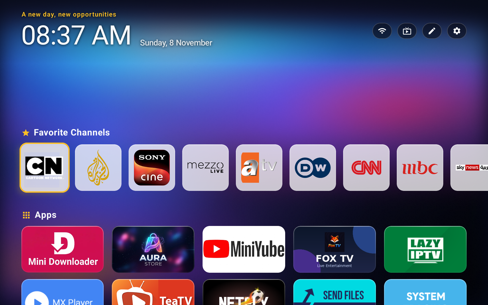
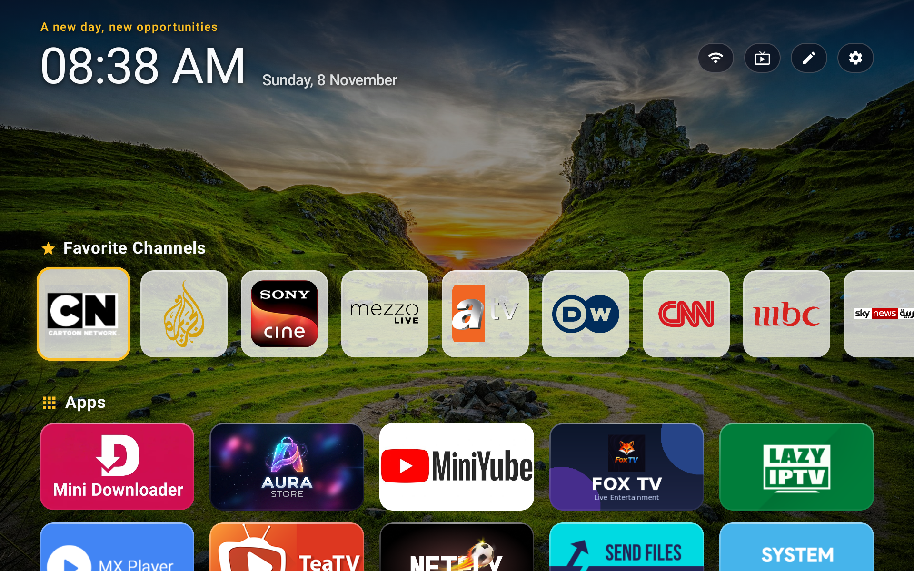
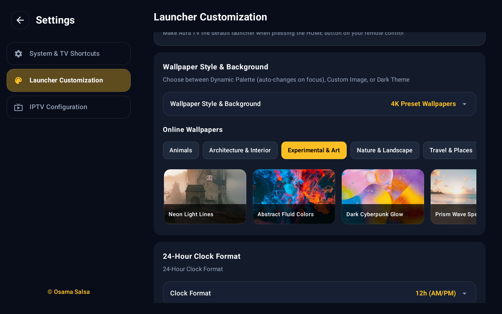
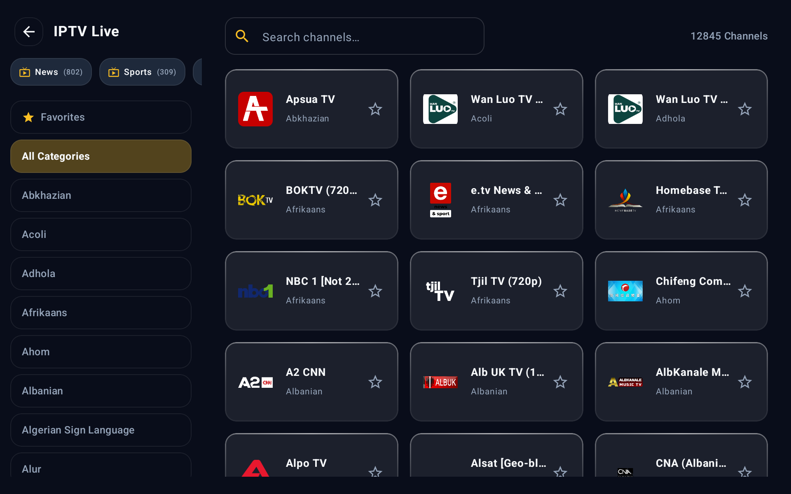
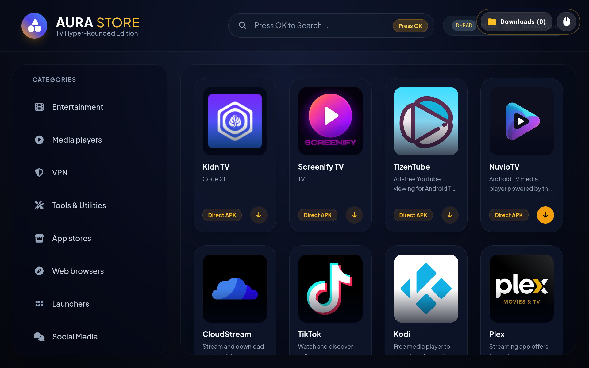
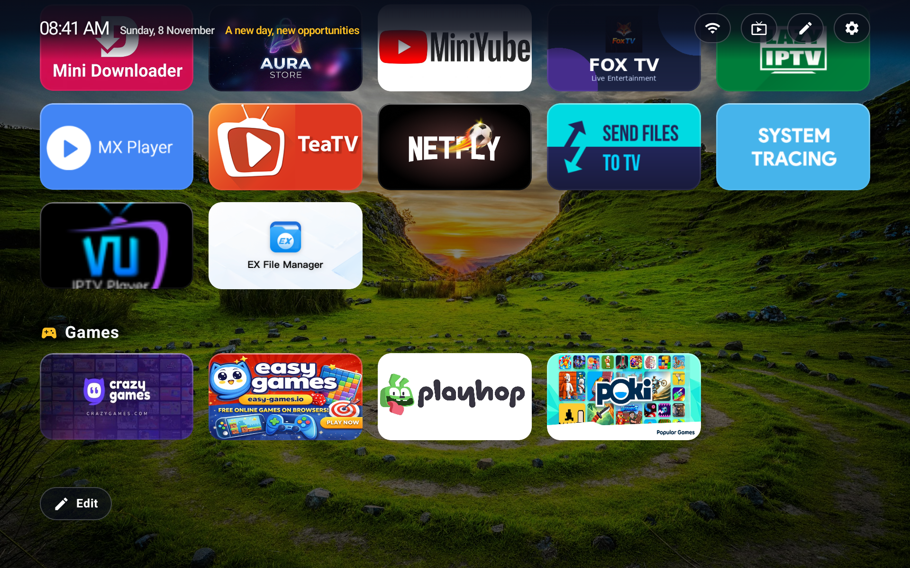
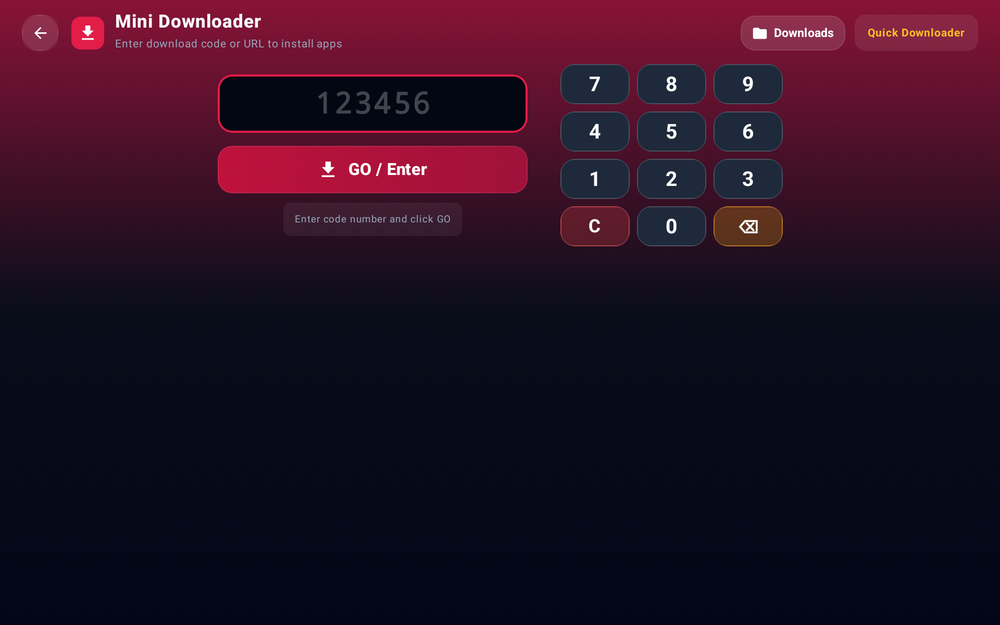

[English](README.md) | [العربية](README_ar.md) | [Deutsch](README_de.md) | [Français](README_fr.md) | [Italiano](README_it.md) | [Русский](README_ru.md) | [Español](README_es.md) | [Português](README_pt.md) | [Türkçe](README_tr.md) | [Polski](README_pl.md) | [Nederlands](README_nl.md) | [Ελληνικά](README_el.md) | [Bahasa Indonesia](README_id.md) | [Tiếng Việt](README_vi.md) | **ไทย** | [中文](README_zh.md) | [日本語](README_ja.md) | [한국어](README_ko.md) | [हिन्दी](README_hi.md) | [اردو](README_ur.md) | [فارسی](README_fa.md)

<div align="center">

# 🌌 Aura TV Launcher

**สัมผัสอนาคตแห่งความบันเทิงภายในบ้านด้วยอินเทอร์เฟซทีวีที่ทันสมัย รวดเร็วเป็นพิเศษ และงดงามระดับภาพยนตร์**

[](https://developer.android.com/tv)
[](https://kotlinlang.org/)
[](https://developer.android.com/jetpack/compose)
[](https://opensource.org/licenses/MIT)
[](https://github.com/OsamaSalsa/Aura-TV-Launcher/releases/latest)

<br>

### 📥 [คลิกที่นี่เพื่อดาวน์โหลดไฟล์ APK เวอร์ชันล่าสุด (พร้อมติดตั้งทันที)](https://github.com/OsamaSalsa/Aura-TV-Launcher/releases/latest/download/aura-tv-launcher.apk)

<br>



</div>

---

## ✨ ภาพรวม

**Aura TV Launcher** ไม่ใช่แค่หน้าจอโฮมธรรมดา แต่เป็นระบบนิเวศความบันเทิงครบวงจรที่ออกแบบมาตั้งแต่ต้นสำหรับ **Android TV และกล่องสมาร์ททีวี (TV Box)** พัฒนาขึ้นด้วย **Kotlin** และ **Jetpack Compose** 100% ผสานความสวยงามระดับภาพยนตร์แบบ "Glassmorphism" เข้ากับเครื่องมือทรงพลังในตัว เช่น เครื่องเล่น **IPTV / ทีวีสด**, **ศูนย์รวมเกมคลาวด์ (Cloud Gaming Hub)**, **ร้านค้าแอป Aura Store** และ **Mini Downloader** สำหรับดาวน์โหลดและติดตั้งไฟล์ APK โดยตรง

ออกแบบมาเพื่อรีโมททีวีโดยเฉพาะ (การนำทางด้วยปุ่มทิศทาง D-Pad) ทุกแอนิเมชัน การซูมเมื่อโฟกัส และการเปลี่ยนหน้าจอได้รับการปรับแต่งให้ทำงานได้อย่างลื่นไหลระดับ 60 FPS โดยไม่มีอาการกระตุก

---

## 🚀 คุณสมบัติหลัก

### 🖥️ 1. หน้าจอหลักระดับภาพยนตร์และมีชีวิตชีวา
* **เอฟเฟกต์โฟกัสอัจฉริยะพร้อมการซูม:** การ์ดแอปจะโดดเด่นขึ้นมาเมื่อเลื่อนไปเลือก พร้อมขอบเรืองแสง เงานุ่มนวล และการขยายขนาดอย่างลื่นไหล
* **ส่วนหัวอัจฉริยะและสภาพอากาศสด:** แสดงคำทักทายตามช่วงเวลาของวัน นาฬิกาแบบเรียลไทม์ (12 ชม. / 24 ชม.) สถานะเครือข่าย (Wi-Fi / Ethernet) และสภาพอากาศในพื้นที่แบบสดๆ
* **รายการโปรดและการปักหมุดด่วน:** ปักหมุดแอปโปรดของคุณไว้ที่แถบเข้าถึงด่วน หรือจัดเรียงลำดับใหม่ได้ทันที
* **รองรับ 21 ภาษา (LTR และ RTL):** แปลภาษาอย่างสมบูรณ์ถึง **21 ภาษา** ได้แก่ ไทย อังกฤษ อาหรับ เยอรมัน ฝรั่งเศส อิตาลี รัสเซีย สเปน โปรตุเกส ตุรกี โปแลนด์ ดัตช์ กรีก อินโดนีเซีย เวียดนาม จีน ญี่ปุ่น เกาหลี ฮินดี อูรดู และเปอร์เซีย

<div align="center">
  
  
</div>

---

### 📺 2. เครื่องเล่น IPTV และทีวีสดในตัว
* **รองรับเพลย์ลิสต์ M3U / M3U8:** เพิ่มเพลย์ลิสต์ IPTV ของคุณเอง หรือรับชมช่องทีวีทั่วโลกที่ติดตั้งมาให้พร้อมใช้งาน
* **ขับเคลื่อนด้วย ExoPlayer (Media3):** เปลี่ยนช่องได้อย่างรวดเร็วทันใจ รองรับสตรีมแบบ HLS และ DASH
* **กรองหมวดหมู่และค้นหา:** กรองช่องตามหมวดหมู่ กีฬา ข่าว ภาพยนตร์ เด็ก หรือพิมพ์ค้นหาชื่อช่องได้ทันที
* **ช่องรายการโปรด:** บันทึกช่องที่คุณรับชมบ่อยที่สุดเพื่อเปิดดูได้ในคลิกเดียวจากหน้าจอหลัก

<div align="center">
  
</div>

---

### 🛍️ 3. Aura Store (ร้านค้าแอปสำหรับทีวี)
* **คัดสรรแอปคุณภาพสำหรับ Android TV:** ดาวน์โหลดและติดตั้งแอปสตรีมมิง เครื่องเล่นมีเดีย เบราว์เซอร์ และเครื่องมือที่ปรับแต่งมาเพื่อหน้าจอทีวีโดยไม่ต้องใช้บัญชี Google
* **ดาวน์โหลดและติดตั้งโดยตรง:** แสดงแถบความคืบหน้าแบบเรียลไทม์พร้อมเปิดหน้าต่างติดตั้งแพ็กเกจอัตโนมัติ

<div align="center">
  
</div>

---

### 🎮 4. พอร์ทัลเกมคลาวด์และเว็บแอป
* **เล่นเกมระดับโลกโดยไม่ต้องมีคอนโซล:** เข้าถึง **Xbox Cloud Gaming**, **NVIDIA GeForce NOW**, **Amazon Luna** และพอร์ทัลเกมเรโทรได้ในคลิกเดียว
* **รองรับจอยเกม (Gamepad):** เชื่อมต่อจอยเกมบลูทูธแล้วเปลี่ยนทีวีของคุณให้กลายเป็นเครื่องเล่นเกมเต็มรูปแบบ

<div align="center">
  
</div>

---

### 📥 5. Mini Downloader และตัวติดตั้ง APK ผ่านลิงก์/รหัสย่อ
* **ดาวน์โหลดผ่าน URL หรือรหัสตัวเลขสั้นๆ:** ป้อนลิงก์ตรงของไฟล์ `.apk` หรือรหัสตัวเลขสั้นๆ ด้วยแป้นพิมพ์บนหน้าจอที่ใช้งานง่ายด้วยรีโมท
* **ประวัติการดาวน์โหลด:** จัดการ ติดตั้งซ้ำ หรือลบไฟล์ APK ที่ดาวน์โหลดไว้ก่อนหน้าได้อย่างง่ายดาย

<div align="center">
  
</div>

---

### 🎨 6. การปรับแต่งขั้นสูงและการควบคุมโดยผู้ปกครอง
* **วอลเปเปอร์ 4K และธีมสี:** เลือกจากวอลเปเปอร์ความละเอียดสูงกว่าหลายสิบแบบ (ธรรมชาติ อวกาศ นามธรรม ไซเบอร์พังก์ มินิมอล) หรือเลือกรูปภาพของคุณเองจากความจำเครื่อง/USB
* **โหมดไอคอนแถบด้านบน:** เลือกแสดงไอคอน **ศูนย์ควบคุมด่วน**, ข้ามศูนย์ควบคุมเพื่อแสดงไอคอน **การตั้งค่าโดยตรง**, หรือ **แสดงทั้งสองไอคอนคู่กัน** บนหน้าจอหลัก
* **รูปแบบวันที่แบบอเมริกันและสากล:** รูปแบบสหรัฐฯ (`MM/dd/yyyy`, `MMMM d, yyyy`, `EEEE, MMMM d, yyyy`, `EEE, MMM d`), สากล (`dd/MM/yyyy`), ISO (`yyyy-MM-dd`), ยุโรป (`dd.MM.yyyy`) หรือซ่อน
* **ปรับขนาด UI และตารางแอป:** ปรับจำนวนคอลัมน์ ขนาดไอคอน และความโปร่งใสของการ์ดได้ตามต้องการ
* **สกรีนเซฟเวอร์ระดับภาพยนตร์และสไลด์โชว์รูปภาพ (`Slideshow`):** แสดงสไลด์โชว์รูปภาพจากโฟลเดอร์ในเครื่อง/USB รูปภาพที่เลือก หรือแกลเลอรี 4K พร้อมตั้งเวลาต่อภาพ (`5 วินาที`–`5 นาที`), การเคลื่อนไหว **Ken Burns / ซูมومนุ่มนวล / ภาพนิ่ง**, 6 เอฟเฟกต์เปลี่ยนภาพ, 7 เอฟเฟกต์บรรยากาศ (**หิมะตก ❄️**, **หิ่งห้อย ✨**, **สายฝน 🌧️**, **ใบไม้ร่วง 🍂**, **ซากุระ 🌸**, **ดวงดาว ⭐**, **โบเก้ 🔮**), นาฬิกามุมจอ และเพลงบรรเลงเบื้องหลังหรือไฟล์ MP3 ของคุณเอง
* **ล็อกแอปด้วยรหัส PIN:** ปกป้องแอปที่ต้องการหรือการตั้งค่าลอนเชอร์ด้วยรหัส PIN 4 หลัก

---

## 🎮 คู่มือการใช้งานปุ่มลัดบนรีโมท

Aura TV Launcher ออกแบบมาให้ควบคุมได้อย่างง่ายดายด้วยรีโมท Android TV มาตรฐานทุกรุ่น:

| ปุ่มบนรีโมท | ตำแหน่งที่ใช้งาน | การทำงาน |
| :--- | :--- | :--- |
| **ปุ่ม OK / เลือก (กดสั้น)** | บนแอปหรือการ์ดใดก็ได้ | เปิดแอป ช่องทีวี หรือพอร์ทัลที่เลือกไว้ |
| **ปุ่ม OK / เลือก (กดค้าง)** | บนไอคอนแอป | เปิด **เมนูตัวเลือกด่วน** (ปักหมุด/เลิกปักหมุด, ย้าย, ซ่อน, ล็อกด้วย PIN, ข้อมูลแอป, ถอนการติดตั้ง) |
| **ปุ่มเมนู (☰ ขีดสามขีด)** | บนแอปหรือหน้าจอหลัก | เปิดเมนูตัวเลือกของแอปที่เลือกอยู่ หรือเปิดแผงการตั้งค่าด่วน |
| **ปุ่มสั่งงานด้วยเสียง / Google Assistant (🎤)** | ทุกที่ในลอนเชอร์ | เปิด **การค้นหาด้วยเสียงอัจฉริยะ** ของ Aura เพื่อค้นหาแอป ช่อง IPTV หรือสั่งงานด้วยเสียง |
| **ปุ่มทิศทาง (D-Pad)** | ทั่วทั้งแอปพลิเคชัน | เลื่อนนำทางระหว่างหมวดหมู่ แอป ช่องทีวี และปุ่มควบคุมการเล่นอย่างลื่นไหล |
| **ปุ่มย้อนกลับ (Back)** | ในหน้าต่างเมนู / เครื่องเล่น | ปิดเมนูที่เปิดอยู่ ออกจากโหมดเต็มจอ หรือกลับไปยังด้านบนสุดของหน้าจอหลัก |

> 💡 **เคล็ดลับ:** คุณสามารถเปิดดูคู่มือปุ่มรีโมทฉบับเต็มได้ภายในแอปที่เมนู **การตั้งค่า > คู่มือการใช้รีโมท**

---

## 🛠️ สถาปัตยกรรมและเทคโนโลยีที่ใช้

* **ภาษาโปรแกรม:** 100% [Kotlin](https://kotlinlang.org/) พร้อม Coroutines และ StateFlow
* **ส่วนติดต่อผู้ใช้ (UI):** 100% [Jetpack Compose](https://developer.android.com/jetpack/compose) + Material Design 3 สำหรับทีวี
* **สถาปัตยกรรม:** MVVM (Model-View-ViewModel) พร้อมการจัดการสถานะ (`UiState`) ที่ชัดเจน
* **ระบบเล่นมีเดีย:** [AndroidX Media3 / ExoPlayer](https://developer.android.com/guide/topics/media/media3) สำหรับสตรีม HLS/M3U8
* **ระบบโหลดภาพ:** [Coil](https://coil-kt.github.io/coil/) พร้อมระบบแคชในดิสก์และหน่วยความจำประสิทธิภาพสูง
* **เครือข่ายและสภาพอากาศ:** OkHttp + Open-Meteo API ดึงข้อมูลสภาพอากาศแม่นยำโดยไม่ต้องใช้ API Key

---

## 📦 วิธีการติดตั้ง

### วิธีที่ 1: ดาวน์โหลดไฟล์ APK โดยตรง (แนะนำ)
1. ดาวน์โหลดไฟล์ [`aura-tv-launcher.apk`](https://github.com/OsamaSalsa/Aura-TV-Launcher/releases/latest/download/aura-tv-launcher.apk) จากหน้า Releases
2. ส่งไฟล์ไปยัง Android TV ของคุณผ่านแฟลชไดรฟ์ USB, แอป *Send Files to TV* หรือ *Downloader*
3. ติดตั้งไฟล์ APK และอนุญาตสิทธิ์ที่จำเป็น
4. กดปุ่ม **Home (โฮม)** บนรีโมท แล้วเลือก **Aura TV Launcher** เป็นหน้าจอหลักเริ่มต้น (**"ตลอดไป"**)

### วิธีที่ 2: คอมไพล์จากซอร์สโค้ด
```bash
git clone https://github.com/OsamaSalsa/Aura-TV-Launcher.git
cd Aura-TV-Launcher
./gradlew assembleDebug
```
ไฟล์ APK ที่คอมไพล์เสร็จแล้วจะอยู่ที่ `app/build/outputs/apk/debug/app-debug.apk`

---

## 🤝 การมีส่วนร่วมและสัญญาอนุญาต

เรายินดีต้อนรับทุกการมีส่วนร่วม การแจ้งบั๊ก และข้อเสนอแนะฟีเจอร์ใหม่ๆ! คุณสามารถเปิด *Issue* หรือส่ง *Pull Request* ได้ตลอดเวลา

เผยแพร่ภายใต้สัญญาอนุญาต **MIT** ดูรายละเอียดเพิ่มเติมได้ในไฟล์ `LICENSE`
